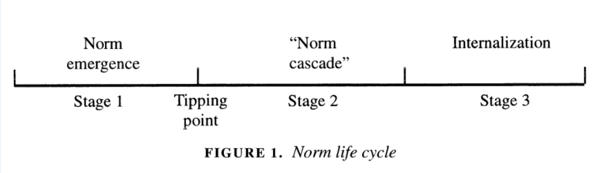

## Today's Agenda {background-image="Images/background-worldmap4.png" .center}

```{r}
# background-size="1920px 1080px"
library(tidyverse)
```

<br>

**IV. What is the Future of Transnational Politics and IR?**

- Should the US enshrine the UN's Universal Declaration of Human Rights into domestic law?

<br>

<br>

::: r-stack
Justin Leinaweaver (Fall 2026)
:::

::: notes
Prep for Class

1. Review Canvas submissions

2. BEFORE CLASS: Take votes from Canvas and build bar plot focused on US (line 237-ish)

3. IN CLASS: Convert ratings on boards to visualization

4. Bring markers x 4

5. Post link to Google Sheet for claiming countries on Canvas
    - First name, Last name, Country 1 - Dictatorship, Country 2 - Democracy
    - Plus include a list of each beside table (see FA23 version)
    
<br>

Today I want us to analyze the UN's role as a norm entrepreneur in creating and propagating the Universal Declaration of Human Rights

- We're undoubtedbly going to get sidetracked a lot, but let's try to keep our eye on evaluating the norm creation process

<br>

**SLIDE**: Basics on the UN DHR

:::


## {background-image="Images/13_3-Roosevelt.png"}

::: notes

The UDHR was adopted by the UN General Assembly on December 10, 1948.

<br>

**Anybody recognize this person?**

- (Eleanor Roosevelt!)

    - Wife of FDR (president 1933-1945)
    
    - Had an incredible career as a diplomat and activst
    
    - "She served as the first Chairperson of the Commission on Human Rights and played an instrumental role in drafting the Universal Declaration of Human Rights" ([UN Link](https://www.un.org/en/observances/human-rights-day/women-who-shaped-the-universal-declaration)).

<br>

**Had anybody ever read this UN document before?**

- **Anything about what it includes that surprised you? Why or why not?**

<br>

Today I want us to analyze the UN DHR as an attempt by the UN to enshrine new global norms

- **SLIDE**: But first, a quick refresher on Constructivism
:::


## Constructivism {background-image="Images/background-worldmap4.png" .center}

+ Actors and structures are mutually constituted

+ Interests and identities are linked and multi-layered

+ Anarchy is an imagined community

+ Power is material AND discursive

+ Change is possible, difficult and a normal part of the process

{style="display: block; margin: 0 auto"}

::: notes

This week we've been exploring Constructivism as an approach to explaining international political events

- **What do we like about this approach to explaining international political events?**

- **What concerns do you have with using this approach to explaining international political events?**

<br>

Last class we explored Finnemore and Sikkink's work on the norm life cycle.

- Today I want us to evaluate the UN DHR using this theoretical map

- Let's make sure we're clear on the three stages

<br>

**What happens in the norm emergence stage?**

- (Norm entrepreneurs actively try to convince their community that some behavior is EITHER:)

    - Desirable and should be required, OR
    
    - Undesirable and should be stopped.

- We can think of Eleanor Roosevelt and the UN General Assembly as doing this work with the DHR

<br>

**What happens in the norm cascade stage?**

- The norm cascade phase is when a norm, having achieved initial support, begins to spread rapidly

- States and organizations adopt it for reasons ranging from:

    - moral conviction,
    
    - reputational benefits, and 
    
    - international pressure 

<br>

**Finally, what is internalization and why is it so powerful?**

- (Internalization: The norm becomes a part of an actor's identity)

- (Powerful: Rules we follow without thinking about it)

    - Once internalized the norm is taken for granted

    - It is now part of how we think and therefore how we act.

    - Very, very hard to dislodge.

<br>

Let's now examine the UN DHR

- *Split class into four groups, mix up the people!*

- Go sit with your groups and grab some board space

<br>

**SLIDE**: The job

:::


## {background-image="Images/background-worldmap4.png" .center}

**Evaluating the UN’s Universal Declaration of Human Rights**

<br>

::: {.incremental}

1. Which articles have been fully internalized at the global level?

2. Which articles should the global community focus on internalizing over the next ten years?

3. Which articles should the US focus on internalizing over the next ten years?

:::

::: notes

Groups, I want you to discuss the articles in the DHR in order to make three lists ON THE BOARD

- **REVEAL x 3**

<br>

Don't set the stage 3 bar too high!

- A norm can be internalized even if broken occasionally
    
- Think about the efforts China and Russia go to in order to justify certain problematic behaviors as consistent with international law

<br>

**Questions on the task?**

- Go!

<br>

*Report Back and Discuss*

**What has the world successfully internalized?**

- **Any doubts on these?**

<br>

**What do you think should be the priority focus for the global community over the next ten years? Why?**

<br>

**And what about for the US specifically?**

- **Where do we need to focus our efforts?**

<br>

**SLIDE**: The US case
:::


## {background-image="Images/background-worldmap4.png" .center}

::: {.r-fit-text}
**The UN’s Universal Declaration of Human Rights (1948)**
:::

{style="display: block; margin: 0 auto"}

<br>

::: {.r-fit-text}
**Where is the US in this process?**
:::

::: notes

**Would your answers change if I asked you to focus on the US alone?**

- **In other words, is the US further along in this process than the global community? Why or why not?**

<br>

**SLIDE**: US law

:::


## {background-image="Images/background-worldmap4.png" .center}

::: {.r-fit-text}
**The UN’s Universal Declaration of Human Rights (1948)**

- Any conflicts with the US legal system?

:::

```{r, fig.align='center', fig.asp=.618, fig.width=7}
# Create object
d1 <- tibble(
  Article = 1:30,
  Votes = 0
  )

# fill in votes
d1$Votes[d1$Article %in% c(2, 4, 5, 9, 12, 13, 14, 15, 19, 21)] <- 1
d1$Votes[d1$Article %in% c(22)] <- 3
d1$Votes[d1$Article %in% c(26)] <- 6
d1$Votes[d1$Article %in% c(23)] <- 15
d1$Votes[d1$Article %in% c(24)] <- 17
d1$Votes[d1$Article %in% c(25)] <- 19

# Output
d1 |>
  ggplot(aes(x = Article, y = Votes)) +
  geom_col() +
  theme_bw() +
  labs(x = "Articles in the UN Declaration of Human Rights", y = "Class Votes",
       title = "Identifying the most problematic articles in the UN DHR") +
  scale_x_continuous(breaks = 1:30)

```

::: notes

In Canvas today I asked you to identify which articles struck you as the toughest fit for the US legal system

<br>

Let's hear your reasoning

- **Why are these the toughest fit for the US system?**

<br>

**SLIDE**: Overall

:::


## Constructivism {background-image="Images/background-worldmap4.png" .center}

+ Actors and structures are mutually constituted

+ Interests and identities are linked and multi-layered

+ Anarchy is an imagined community

+ Power is material AND discursive

+ Change is possible, difficult and a normal part of the process

{style="display: block; margin: 0 auto"}

::: notes

**So, where are we in the norm life cycle with the UN's DHR?**

<br>

- **How close do you think we are to a "tipping point" of wide acceptance?**

- **Which rights are furthest away?**
:::


## Assignment for Next Class  {background-image="Images/background-worldmap4.png" .center}

<br>

Claim a democracy and a dictatorship (first-come, first-served) and review their current human rights record using:

1. The country reports by the US Department of State
2. The country reports by Amnesty International
3. The country reports by Human Rights Watch

Submit reflections on Canvas

::: notes

Next week we explore the power of publicity to reduce human rights violations.

- To get us ready for that, I want to get you some practice with some of the key pieces of evidence that research draws on.

<br>

Technically I've given you a list of "most" and "least" democratic states in the world according to the V-Dem project's electoral democracy index.

<br>

**Questions on the assignment?**
:::