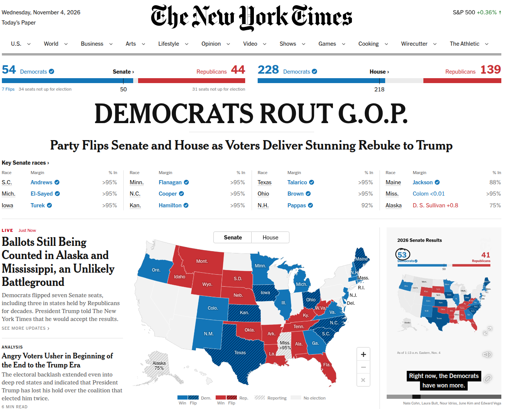
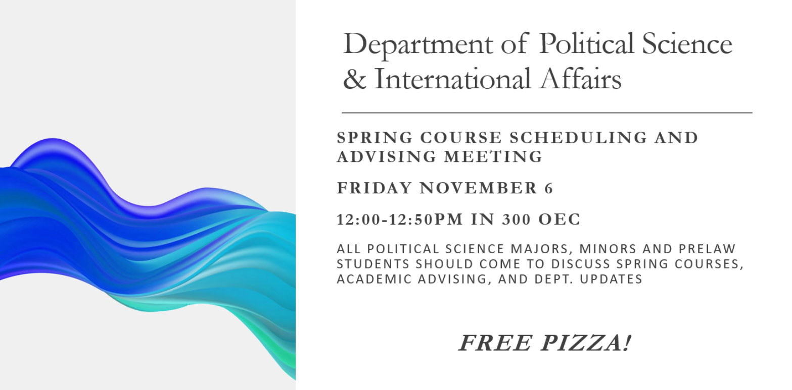
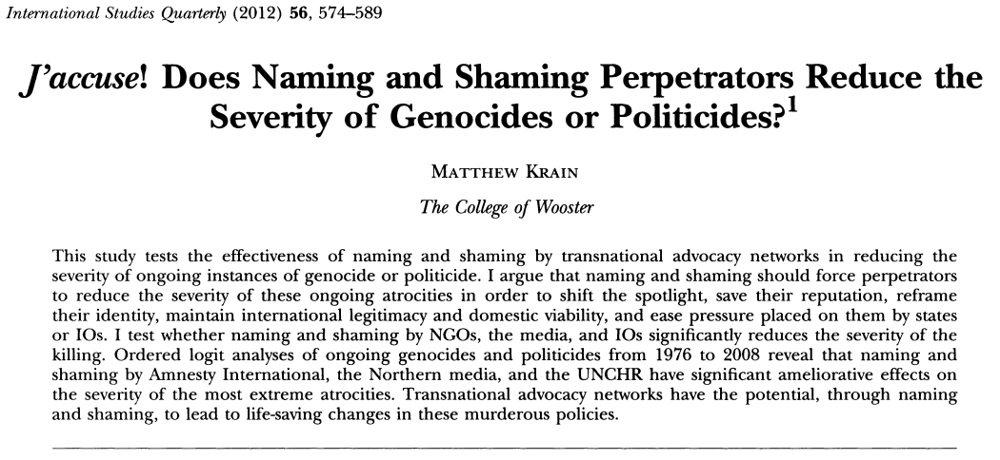
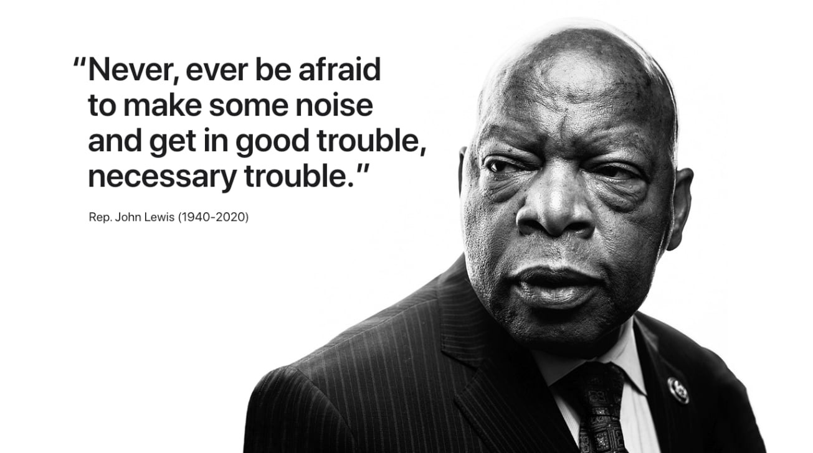
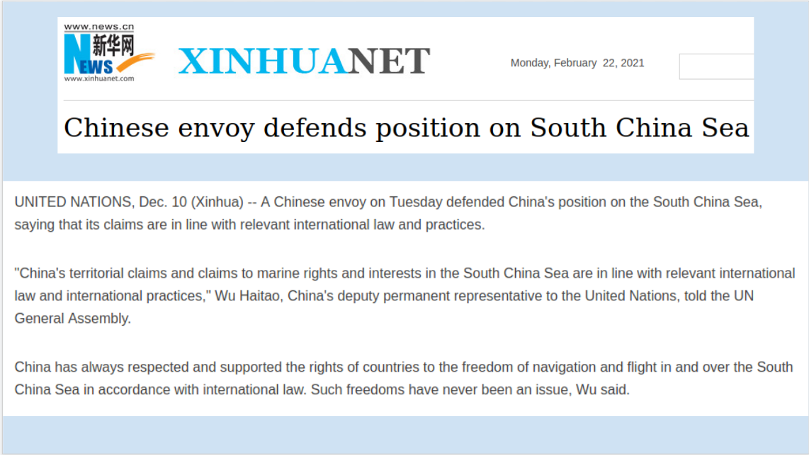
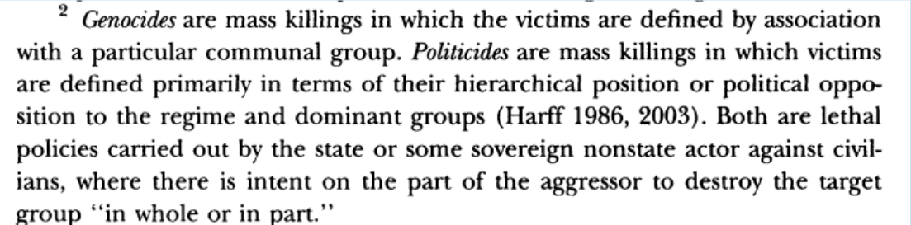

## Today's Agenda {background-image="Images/background-worldmap4.png" .center}

```{r}
# background-size="1920px 1080px"
library(tidyverse)
library(readxl)
library(kableExtra)
```

<br>

**IV. What is the Future of Transnational Politics and IR?**

- Krain (2012) on naming and shaming "bad" states

<br>

<br>

::: r-stack
Justin Leinaweaver (Fall 2026)
:::

::: notes
Prep for Class

1. Review Canvas submissions

<br>

**SLIDE**: The election happened!

**SLIDE**: Announce advising session

:::


## {background-image="Images/background-worldmap4.png" .center}

{style="display: block; margin: 0 auto"}

::: notes

**Did everybody vote yesterday?**

<br>

**What happened yesterday?**

- **Early takeaways?**

<br>

**What do these results means for American foreign policy over the next two months while Republicans hold all the levers of power?**

<br>

**How about over the next two years once Congress is controlled by the Democrats?**

<br>

We'll have to keep an eye on things!

- **SLIDE**: As long as we're discussing the future, let's talk Spring scheduling!

:::


## {background-image="Images/background-worldmap4.png" .center}

{style="display: block; margin: 0 auto"}


## Comparative Case Studies {background-image="Images/background-worldmap4.png" .center}

<br>

What do we learn about human rights violations in the world today?

+ Most common "human rights" violations?

+ Who specifically in the country is doing the harms?

+ How are victims being targeted?

::: notes

On Monday we explored a series of case studies describing human rights abuses around the world and the naming and shaming efforts made by certain NGOs to stop them.

<br>

**What conclusions did we draw from comparing and contrasting those cases?**
:::


## {background-image="Images/background-worldmap4.png" .center}



::: notes

Today we shift our focus to a research article that hopefully advances our knowledge about the topic.

<br>

**What is the research question in the Krain (2012) paper?**

<br>

The title is a big hint, right?

- Does Naming and Shaming Perpetrators Reduce the Severity of Genocides or Politicides?

<br>

**Based only on the introduction of this article, how has the author tried to convince you that this is a clear and important question?**

- *Force this discussion*

<br>

Let's clarify a few elements of this before diagramming the model in this paper.

- **First, why is this paper a good test of Constructivism as we began exploring it last week?**

:::


## Discourse as Power {background-image="Images/background-worldmap4.png"}

{.absolute width="400" left=0 top=75}

{.absolute width="650" right=0 bottom=100}


::: notes

**Remind me, what does this mean?**

- (Hopf (1988) and the power of discourse!)

- Ideas and the framing of issues as a source of power as important, if not more important, than tanks, bombs or wealth.

<br>

**The first reason** this paper is a good test of Constructivism is it puts the discourse as power mechanism to the test.

- We assume states commit violent acts for reasons they feel strongly about.

- The intriguing question is, can the discourse power overcome those reasons?

:::


## The Power of Global Norms {background-image="Images/background-worldmap4.png" .center}



::: notes

**The second reason** this paper is a good test of Constructivism is it explores how much global norms matter.

- Do widely accepted rules, not written down international laws, constrain state actions?

<br>

As we know China has strong territorial ambitions in the South China Sea.

- It also has the capacity to take that area by force although that would likely lead to war.

<br>

The Chinese government is working hard on the international stage to build the perceived legitimacy of their claims.

- They acknowledge the "relevant" "international practices" and the "rights of countries to the freedom of navigation and flight over the South China Sea..."

<br>

So, Krain (2012) is playing with mechanisms that constructivism makes clear should be very important for explaining international political outcomes. 

<br>

**Any questions on this?**
:::


## {background-image="Images/background-worldmap4.png" .center}


::: notes

Before we talk about the model, let's clarify the central outcome concepts in the paper.

<br>

**What are the specific international violations Krain (2012) is focused on?**

- **What is the outcome variable in the study?**

- (Genocide and politicide)

<br>

**How does Krain define a "genocide" and a "politicide"?**

- (**SLIDE**: Footnote 2, p574)
:::


## Krain (2012): Key Concepts {background-image="Images/background-worldmap4.png" .center}

<br>

```{r, fig.align='center'}

```

::: notes

(Footnote 2, p574)

"Genocides are mass killings in which the victims are defined by association with a particular communal group.

Politicides are mass killings in which victims are defined primarily in terms of their hierarchical position or political opposition to the regime and dominant groups (Harff 1986, 2003).

Both are lethal policies carried out by the state or some sovereign nonstate actor against civilians, where there is intent on the part of the aggressor to destroy the target group ‘‘in whole or in part.’’

<br>

**Why do we need both concepts? Doesn't genocide cover it all?**

- (Krain not super interested in litigating the specific form of objectionable murder.)

- (Aim is to see if naming and shaming ends any and all forms of mass killing outside of legitimate security actions by the state.)
:::


## Krain (2012): Hypothesis {background-image="Images/background-worldmap4.png" .center}

<br>

"Increases in human rights 'naming and shaming' activity against perpetrators of an ongoing genocide or politicide by actors within transnational advocacy networks should reduce the severity of genocide or politicide" (577).

::: notes

Here is the hypothesis in the paper.

- **Remind me, how do the hypotheses relate to the model?**

<br>

(The hypotheses represent the testable implications of a model)

- The model lays out a set of assumptions about the world.

- When you combine those assumptions you generate predictions about what we should see happen in a specific situation.

- Those predictions are the hypotheses.

<br>

Let's make sure we're clear on this with some practice

<br>

**What is a testable hypothesis of neorealism?**

- (The premises focused on states pursuing security in an anarchic world lead to hypotheses about)
    
    - (The security dilemma)

    - (Lack of meaningful cooperation)

<br>

**What is a testable hypothesis of economic liberalism?**

- (The premises focused on states pursuing gains through trade lead to hypotheses about)

    - (Specialization and peace)

<br>

Back to the slide

- What we have here is a prediction about the world generated using Krain's (2012) model.

<br>

Our first job is to figure out the key elements of this model so we can evaluate it.
:::


## Krain (2012) {background-image="Images/background-worldmap4.png" .center}

<br>

::: {.r-fit-text}
**Diagram the Model**

+ Who are the key **Interests**?

+ What are the key **Institutions**?

+ What are the key **Interactions**?
:::

::: notes

Canvas assignment for today means everybody has taken a first stab at this exercise.

<br>

Work in small groups with the people around you

- Let's focus first on the **interests** of the model

- Share what you came up with and get ready to report back to the class.

<br>

**Ok, who are the interests in Krain's model and what do they want?**

- (**SLIDE**: Interests)

:::


## {background-image="Images/background-worldmap4.png" .center .smaller}

**Interests**

+ Leaders of states care about their reputations and legitimacy

::: {.fragment}

**Institutions**

+ Global norm: Genocide / Politicide is not legitimate

:::

::: {.fragment}

**Interactions**

Naming and shaming (N&S) by NGOs or IOs:

+ Exposes the crimes (public not private)
+ Raises the profile of the crimes (global not domestic)
+ May change perpetrators' self-perceptions
+ Activates bystanders
+ Encourages state sanctions
+ May cost the perpetrator state access to aid or trade

:::

::: notes

Ok, talk to me about this modeling choice.

- Remember, the aim of the Krain model is to explain how discourse could reduce political violence

- That means the key choice we are explaining is focused on leaders and whether or not they commit atrocities

- **So, what are the strengths and weaknesses of analyzing political violence by focusing exclusively on these actors?**

<br>

**Why don't we include NGOs or IOs as an interest in this model?**

- (We aren't trying to explain their decision to name and shame)

- (We are trying to explain what happens to leader decision-making when they do!)

<br>

Back to your small groups!

- Get ready to report back on the institutions in this model

<br>

**Ok, report back!**

<br>

**REVEAL: And what are the strengths and weaknesses of analyzing political violence by focusing exclusively on these institutions?**

- **Anything important missing from this list?**

<br>

Back to your small groups!

- Get ready to report back on the interactions in this model

- **Specifically, how does naming and shaming impact the key interests in this model?**

<br>

**Ok, what do you got?**

<br>

**REVEAL: And what are the strengths and weaknesses of assuming naming and shaming can do all of these things?**

- **Are you convinced by them?**

:::


## {background-image="Images/background-worldmap4.png" .center .smaller}

**Interests**

+ Leaders of states care about their reputations and legitimacy

**Institutions**

+ Global norm: Genocide / Politicide is not legitimate

**Interactions**

Naming and shaming (N&S) by NGOs or IOs:

+ Exposes the crimes (public not private)
+ Raises the profile of the crimes (global not domestic)
+ May change perpetrators' self-perceptions
+ Activates bystanders
+ Encourages state sanctions
+ May cost the perpetrator state access to aid or trade

::: notes

Alright, let's evaluate this model of political violence.

<br>

**Big picture, what do we think is most useful about this model?**

<br>

**And what concerns do we have with using it?**

- **Is it missing anything you intuitively believe is important for explaining mass killings?**

:::


## Assignment for Next Class  {background-image="Images/background-worldmap4.png" .center}

<br>

Krain (2012) on naming and shaming "bad" states

- How convinced by this analysis are you?

::: notes
Friday we dig into the data analyses in the paper.

- Your job for Friday is to start thinking about what specifically he did to test the model and whether you are convinced by it or not.

:::